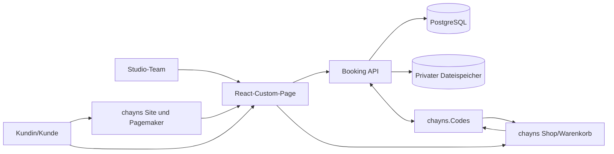
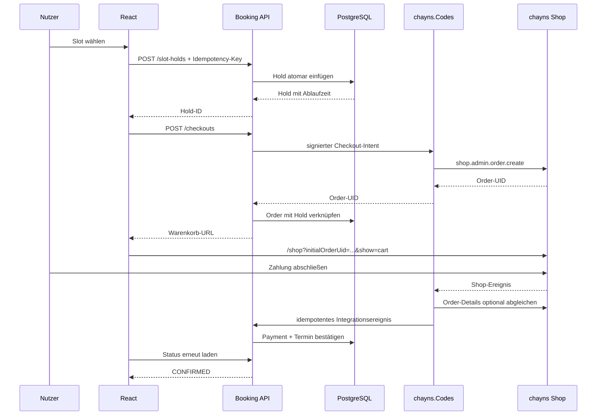

# Architektur- und Umsetzungskonzept: Tattoo-Studio auf chayns

> Arbeitsstand: 28. August 2026  
> Status: technische Zielarchitektur für MVP und Ausbau  
> Fachliche Grundlage: [Vorkonzept Tattoo-Studio](./VORKONZEPT_TATTOO_STUDIO_CHAYNS.md)  
> Leitentscheidung: chayns für Site, Identität, Shop und Plattformereignisse; eigener transaktionaler Buchungskern für Termine

## 1. Ergebnis in einem Satz

Das Projekt wird als hybride chayns-Lösung umgesetzt: redaktionelle Seiten im Pagemaker, eine selbst gehostete React-Custom-Page für Anfrage und Buchung, der native chayns Shop für Anzahlungen, chayns.Codes als Integrationsadapter und eine eigene TypeScript-/PostgreSQL-Booking-API als verbindliche Quelle für Kalender, Projekte und Zahlungszuordnung.

## 2. Architekturziele

Die Architektur muss folgende Eigenschaften sicherstellen:

- keine Doppelbuchung von Artist oder Arbeitsplatz,
- Terminbestätigung erst nach einem belastbaren Shop-Ereignis,
- vollständige Nachvollziehbarkeit von Anfrage, Hold, Bestellung und Termin,
- hohe Designfreiheit im Buchungsprozess bei konsistentem chayns-Auftritt,
- klare Trennung zwischen redaktionellem Inhalt und Geschäftsanwendung,
- sichere Verarbeitung von Kundendaten und privaten Bild-Uploads,
- austauschbare Hosting- und Infrastrukturkomponenten,
- wiederholbare Deployments und Datenbankmigrationen,
- idempotente Verarbeitung von Requests und Plattformereignissen,
- schrittweise Erweiterbarkeit um Folgesitzungen, Warteliste und Nachsorge.

## 3. Systemkontext



### 3.1 Systemgrenze

Zum eigenen System gehören:

- React-Anwendung,
- Booking API,
- PostgreSQL-Datenbank,
- privater Dateispeicher,
- Hintergrundjobs und Monitoring,
- Codes-Projekte für Shop- und chayns-Integration.

Außerhalb der eigenen fachlichen Kontrolle liegen:

- chayns Login und Identitätsverwaltung,
- Pagemaker und chayns Site-Navigation,
- chayns Shop, Warenkorb und Zahlungsoberfläche,
- Ausführung und Zustellung von chayns-Plattformereignissen.

## 4. Verbindliche Verantwortungsgrenzen

| Fähigkeit | Verbindliches System | Begründung |
|---|---|---|
| Öffentliche Inhalte | chayns Pagemaker | ohne Deployment redaktionell pflegbar |
| Anfrage- und Buchungsoberfläche | React-Custom-Page | komplexer, zustandsbehafteter Workflow |
| Benutzeridentität | chayns ID | einheitlicher Login und `personId` |
| Rollen und Objektberechtigungen | Booking API | Rechte müssen serverseitig gelten |
| Tattoo-Projekte und Anfragen | Booking API/PostgreSQL | relationale Historie und Datenschutz |
| Kalender und Slot-Holds | Booking API/PostgreSQL | Transaktionen und Überschneidungsschutz |
| Anzahlungsartikel | chayns Shop | Voraussetzung für nativen Checkout |
| Bestellerzeugung | chayns.Codes | `shop.admin.order.create` |
| Warenkorb und Zahlung | chayns Shop | native Zahlungsabwicklung |
| Bestellereignisse | chayns.Codes | MQTT-/Shop-Integration |
| Zahlungszuordnung | Booking API/PostgreSQL | Termin darf nicht vom Frontend bestätigt werden |
| Referenzbilder | privater Dateispeicher | Zugriffsschutz und kontrollierte Löschung |
| Audit-Log | Booking API/PostgreSQL | unveränderbare fachliche Nachvollziehbarkeit |

## 5. Seiten- und UX-Architektur

### 5.1 Pagemaker

Der Pagemaker verwaltet Inhalte, die das Studio selbst häufig ändern soll:

- Startseite,
- Studio und Artists,
- Portfolio-Auswahl,
- Ablauf und Preisorientierung,
- FAQ, Vorbereitung und Pflege,
- Kontakt, Anfahrt und Rechtliches.

### 5.2 React-Custom-Page

Die vollständige Custom Page enthält:

- mehrstufige Tattoo-Anfrage,
- Referenz-Uploads,
- Terminoptionen und Kalender,
- Checkout-Vorbereitung,
- Kundenbereich „Meine Tattoos“,
- interne Anfrage-Pipeline,
- Studio-Kalender und Admin-Funktionen.

Die Anwendung wird mit `create-chayns-app` erstellt, per HTTPS selbst gehostet oder als Build in den chayns Space geladen und in der Administration als „External website“ eingebunden.

### 5.3 Nativer Shop

Der Warenkorb bleibt eine native chayns-Seite. Die React-Anwendung übernimmt Farben, Typografie und Komponenten aus dem chayns-Kontext, damit der Übergang in den Shop nicht wie ein Systemwechsel wirkt.

## 6. Komponenten

### 6.1 Web-App

Empfohlener Stack:

- React und TypeScript,
- chayns API v5 und `ChaynsProvider`,
- chayns Components für Grundelemente,
- React Router beziehungsweise chayns History-Integration,
- TanStack Query für Serverzustand,
- React Hook Form und schema-basierte Validierung,
- Vitest, Testing Library und Playwright.

Die Web-App enthält keine Geschäftsgeheimnisse, Shop-Administrationsdaten oder verbindliche Kalenderlogik. Eine ausgeblendete Schaltfläche ist niemals eine Berechtigungsprüfung.

### 6.2 Booking API

Empfohlener Stack:

- Node.js und TypeScript,
- Fastify als HTTP-Server,
- Zod für Request-/Response-Schemas,
- PostgreSQL-Treiber und Drizzle oder Kysely für typisierte Datenzugriffe,
- SQL-Migrationen für Range- und Exclusion-Constraints,
- OpenAPI-Dokumentation aus denselben Schemas,
- strukturierte JSON-Logs und verteilte Request-IDs.

Die API bleibt zustandslos. Geschäftszustand wird ausschließlich in PostgreSQL beziehungsweise im privaten Dateispeicher gehalten.

### 6.3 PostgreSQL

PostgreSQL ist die Source of Truth für:

- Nutzerzuordnung und Rollen,
- Anfragen und Projekte,
- Verfügbarkeiten und Sperrzeiten,
- Holds, Termine und Ressourcen,
- Quotes und Deposit-Zuordnung,
- Shop-Bestellungen und Payment-Ereignisse,
- Benachrichtigungsaufträge und Audit-Log.

### 6.4 chayns.Codes-Adapter

Codes übernimmt nur chayns-spezifische Aufgaben:

- Bestellung mit `shop.admin.order.create` erzeugen,
- zurückgegebene Order-UID an die Booking API liefern,
- Shop-Ereignisse empfangen,
- Order-Details über `shop.statistics.orders.getById` abgleichen,
- Nachrichten über chayns versenden,
- optionale zeitgesteuerte Ausgleichs- oder Erinnerungsfunktionen ausführen.

Der Codes-Key-Value-Speicher kann technische Idempotency-Zuordnungen wie `checkoutRequestId → orderUid` halten. Fachliche Kalender- und Kundendaten verbleiben in PostgreSQL.

### 6.5 Hintergrundjobs

Ein separater Worker verarbeitet:

- abgelaufene Slot-Holds,
- Outbox-Ereignisse,
- Checkout-Wiederholungen,
- ausstehende Shop-Ereignisse und Ausgleichsläufe,
- Erinnerungen,
- Lösch- und Aufbewahrungsregeln.

Für das MVP kann Worker und API aus demselben Codebestand in getrennten Prozessen laufen.

## 7. Identität und Autorisierung

### 7.1 Anmeldung

1. React liest den chayns-Nutzerkontext.
2. Für persönliche oder zahlungspflichtige Vorgänge ist ein gültiger Login erforderlich.
3. React sendet den chayns Access Token als Bearer Token an die Booking API.
4. Die Booking API validiert Token, Aussteller, Zielsystem, Ablauf und Site-Zuordnung über den offiziell unterstützten Backend-Mechanismus.
5. Die API übernimmt `personId` niemals ungeprüft aus einem Formularfeld.

Die genaue serverseitige Tokenvalidierung wird vor Implementierung in einem Auth-Spike gegen eine reale chayns Site getestet.

### 7.2 Rollen

| Rolle | Zugriff |
|---|---|
| Kunde | ausschließlich eigene Anfragen, Projekte, Termine und Uploads |
| Artist | zugewiesene Projekte und eigener Kalender |
| Management | Anfragen, Kalender, Zahlungen und Kommunikation |
| Admin | Stammdaten, Rollen, Regeln und Audit-Auswertungen |

Jede Datenbankabfrage wird bereits auf den berechtigten Mandanten, Nutzer oder Artist eingeschränkt. Das Frontend filtert nur zusätzlich für die Darstellung.

## 8. Kalender- und Verfügbarkeitsmodell

### 8.1 Zeitmodell

- Speicherung aller Zeitpunkte in UTC,
- Darstellung und Eingabe in `Europe/Berlin`,
- Intervalle nach dem Muster `[Start, Ende)`, sodass ein Termin exakt am Ende des vorherigen beginnen darf,
- Puffer werden als Teil des belegten Blocks gespeichert,
- Sommer-/Winterzeitfälle werden automatisiert getestet.

### 8.2 Berechnung freier Slots

Die API berechnet Verfügbarkeit aus:

```text
regelmäßige Artist-Verfügbarkeit
- Urlaub/Krankheit/Sperrzeiten
- bestätigte Termine
- aktive Holds
- Vor- und Nachpuffer
- belegte Arbeitsplätze
= buchbare Zeitfenster
```

Lange Tattoo-Sitzungen werden nicht aus einer festen Liste starrer 30-Minuten-Termine zusammengesetzt. Das interne Raster dient nur zum Finden möglicher Startzeiten; gespeichert wird immer das reale Zeitintervall.

### 8.3 Atomarer Slot-Hold

Der Hold wird in einer Datenbanktransaktion erzeugt:

1. Idempotency-Key prüfen.
2. Abgelaufene konkurrierende Holds aktualisieren.
3. Artist-, Ressourcen- und Geschäftsregeln prüfen.
4. blockierendes Intervall einfügen.
5. Hold mit `expires_at` zurückgeben.

PostgreSQL schützt zusätzlich unabhängig vom Anwendungscode vor Überschneidungen. Beispiel für den Artist:

```sql
CREATE EXTENSION IF NOT EXISTS btree_gist;

ALTER TABLE appointment_blocks
ADD CONSTRAINT appointment_blocks_artist_no_overlap
EXCLUDE USING gist (
    artist_id WITH =,
    tstzrange(block_start, block_end, '[)') WITH &&
)
WHERE (status IN ('HELD', 'PAYMENT_PENDING', 'CONFIRMED'));
```

Eine entsprechende Regel gilt für den Arbeitsplatz. Ein Constraint-Konflikt wird als HTTP `409 Conflict` beantwortet; das Frontend lädt danach neue Vorschläge.

## 9. Fachliches Datenmodell

### 9.1 Zentrale Tabellen

| Tabelle | Wesentliche Felder |
|---|---|
| `customers` | ID, chayns `person_id`, Status, Zeitstempel |
| `artists` | Profil, aktive Rolle, Kalenderregeln |
| `resources` | Arbeitsplatz, Typ, Status |
| `service_types` | Dauer, Puffer, Buchungsmodus, Deposit-Tier |
| `availability_rules` | Artist, Wochentag, lokales Zeitfenster, Gültigkeit |
| `blocked_periods` | Artist/Ressource, Start, Ende, Grund |
| `inquiries` | Kunde, Anfrageinhalt, Status, Zuweisung |
| `tattoo_projects` | Kunde, Artist, Projektstatus, Preisrahmen |
| `quotes` | Dauer, Deposit-Artikel, Gültigkeit, Version |
| `appointment_blocks` | Artist, Ressource, Start, Ende, Status, Ablauf |
| `appointments` | Projekt, Block, Termintyp, Kundenstatus |
| `shop_orders` | Order-UID, Shop-ID, Person-ID, Artikel, Hold, Status |
| `payment_events` | externe Event-ID, Order-UID, Typ, Payload-Hash, Ergebnis |
| `media_assets` | Eigentümer, Zweck, Speicher-Key, Sichtbarkeit |
| `consents` | Typ, Textversion, Zeitpunkt, Widerruf |
| `outbox_events` | Ereignistyp, Payload, Status, Versuche |
| `audit_events` | Akteur, Aktion, Objekt, Vorher/Nachher, Zeitpunkt |

### 9.2 Statusmodelle

Terminblock:

```text
HELD → PAYMENT_PENDING → CONFIRMED → COMPLETED
  └──────────────→ EXPIRED
  └──────────────→ CANCELLED
```

Shop-Zuordnung:

```text
NOT_CREATED → CREATING → CART_READY → EVENT_RECEIVED → PAID
                    └──────────────→ FAILED/EXPIRED
PAID → REFUND_PENDING → REFUNDED/PARTIALLY_REFUNDED
```

Die Bezeichnungen `PAID` und `REFUNDED` werden nur gesetzt, wenn die dafür erforderliche Aussage aus dem realen Shop-Ereignis beziehungsweise dem validierten Erstattungsprozess nachgewiesen ist.

## 10. API-Konzept

### 10.1 Kunden-API

| Methode | Route | Zweck |
|---|---|---|
| `POST` | `/v1/inquiries` | Tattoo-Anfrage anlegen |
| `GET` | `/v1/me/projects` | eigene Projekte anzeigen |
| `POST` | `/v1/uploads` | privaten Upload vorbereiten |
| `GET` | `/v1/availability` | mögliche Zeitfenster ermitteln |
| `POST` | `/v1/slot-holds` | Slot atomar halten |
| `DELETE` | `/v1/slot-holds/{id}` | eigenen Hold freigeben |
| `POST` | `/v1/checkouts` | Deposit-Checkout erzeugen |
| `GET` | `/v1/checkouts/{id}` | Checkout-/Zahlungsstatus abfragen |
| `POST` | `/v1/appointments/{id}/reschedule-requests` | Umbuchung anfragen |
| `POST` | `/v1/appointments/{id}/cancellation-requests` | Storno anfragen |

### 10.2 Studio-API

| Methode | Route | Zweck |
|---|---|---|
| `GET/PATCH` | `/v1/admin/inquiries/...` | Anfrage-Pipeline bearbeiten |
| `POST` | `/v1/admin/quotes` | Angebot und Deposit-Tier festlegen |
| `GET` | `/v1/admin/calendar` | Studio-/Artist-Kalender laden |
| `POST` | `/v1/admin/blocked-periods` | Urlaub und Sperrzeit anlegen |
| `POST` | `/v1/admin/appointments` | internen Termin anlegen |
| `POST` | `/v1/admin/appointments/{id}/reschedule` | Termin atomar umbuchen |
| `GET` | `/v1/admin/payments` | Zahlungszuordnungen anzeigen |

### 10.3 Integrations-API

| Methode | Route | Zweck |
|---|---|---|
| `POST` | `/v1/integrations/chayns/shop-events` | qualifiziertes Shop-Ereignis übernehmen |
| `POST` | `/v1/integrations/chayns/order-created` | Order-UID einem Checkout zuordnen |
| `GET` | `/v1/integrations/chayns/checkout-intents/{id}` | von Codes freigegebene Orderdaten abrufen |

Integrationsrouten verwenden eine getrennte Maschinen-Authentifizierung, enge Rate Limits, Event-IDs und eine Wiederholungssperre.

## 11. Checkout- und Bestätigungsablauf



### 11.1 Fehler- und Wiederholungsfälle

- **Codes nicht erreichbar:** Hold bleibt befristet; Checkout kann mit demselben Idempotency-Key wiederholt werden.
- **Order erzeugt, Antwort verloren:** Codes speichert die technische Request-ID zur Order-UID; ein Ausgleichsjob sucht den bekannten Vorgang.
- **Shop verlassen:** Hold läuft ab, solange kein qualifiziertes positives Ereignis eintrifft.
- **Ereignis doppelt:** Unique Constraint auf externer Event-ID beziehungsweise Kombination aus Order-UID und Eventtyp verhindert Doppelverarbeitung.
- **Ereignis verspätet nach Hold-Ablauf:** Vorgang wird in `MANUAL_REVIEW` gestellt; kein anderer Termin wird automatisch verdrängt.
- **Order-Daten passen nicht:** Person-ID, Artikel und Menge werden abgelehnt und als Sicherheitsereignis protokolliert.

`shop.statistics.orders.getById` liefert laut aktuellem Schema Order, Person und Artikel, aber keinen eindeutig dokumentierten finalen Zahlungsstatus. Die Funktion dient deshalb zur Zuordnungsprüfung, nicht allein als Zahlungsnachweis. Welche MQTT-Payload einen bezahlten Abschluss sicher kennzeichnet, ist ein Muss-Kriterium des Shop-Spikes.

## 12. Deposit- und Shop-Modell

Für das MVP werden feste Artikel verwendet:

| Deposit-Tier | Beispielartikel | Verwendung |
|---|---|---|
| `D50` | Anzahlung 50 € | Beratung/kleine Sitzung |
| `D100` | Anzahlung 100 € | Standardsitzung |
| `D150` | Anzahlung 150 € | Halb-/Tagessitzung |
| `FULL_FLASH` | konkretes Flash-Motiv | optionale Vollzahlung |

Die Booking API entscheidet anhand des versionierten Quotes, welcher Artikel zulässig ist. Das Frontend darf keine beliebige Artikel-ID oder Preisangabe an Codes übergeben. Individuelle Beträge, Teilrückzahlungen und Restzahlungen werden erst nach einem eigenen Ende-zu-Ende-Test freigeschaltet.

## 13. Zuverlässigkeit und Idempotenz

### 13.1 Idempotency-Key

Schreibende Kundenoperationen erhalten einen UUID-basierten `Idempotency-Key`. Gespeichert werden Nutzer, Route, normalisierter Request-Hash, Ergebnis und Ablaufzeit. Derselbe Key mit anderem Payload wird abgewiesen.

### 13.2 Transactional Outbox

Terminstatus und auszulösendes Ereignis werden in derselben Datenbanktransaktion gespeichert. Der Worker übermittelt anschließend das Outbox-Ereignis. Erst nach bestätigter Zustellung wird es abgeschlossen. Dadurch geht bei einem Prozessabsturz keine erforderliche Folgeaktion verloren.

### 13.3 Reconciliation

Regelmäßige Ausgleichsläufe suchen:

- `CREATING` ohne Order-UID,
- `CART_READY` ohne Ereignis nach Ablauf der Zahlungsfrist,
- positive Shop-Ereignisse ohne bekannten Checkout,
- `PAID` ohne bestätigten Termin,
- bestätigte Termine ohne zugeordnete Zahlung, falls eine Zahlung vorgeschrieben ist.

## 14. Upload- und Datenschutzarchitektur

- Uploads laufen über zeitlich begrenzte signierte URLs.
- Der Browser erhält keine allgemeinen Speicherzugangsdaten.
- Erlaubte Dateitypen, Größe und Anzahl werden serverseitig geprüft.
- Metadaten und Speicherobjekt werden erst nach erfolgreicher Prüfung miteinander verknüpft.
- Referenzen, Entwürfe, Gesundheitsangaben und Portfoliofreigaben erhalten getrennte Zugriffsklassen.
- Gesundheitsangaben werden nicht in Push-Nachrichten, Logs oder Analytics geschrieben.
- Lösch- und Aufbewahrungsjobs arbeiten nach Datenklasse und dokumentiertem Rechtszweck.
- Backups werden verschlüsselt; Wiederherstellung wird regelmäßig getestet.

## 15. Sicherheitskonzept

- HTTPS an allen Übergängen,
- serverseitige Token- und Rollenprüfung,
- getrennte Secrets für Entwicklung, Staging und Produktion,
- keine Secrets im React-Build,
- Maschinen-Authentifizierung zwischen Booking API und Codes,
- Rate Limits für Login-nahe, Upload- und Buchungsrouten,
- Payload- und Größenlimits,
- parametrisierte Datenbankzugriffe,
- Audit-Log für Rechte-, Termin-, Payment- und Einwilligungsänderungen,
- Content Security Policy und eng gefasste erlaubte Ursprünge,
- automatische Abhängigkeits- und Containerprüfungen,
- Notfallprozess zum Sperren von Shop-Checkout oder Direktbuchung.

## 16. Repository-Struktur

Empfohlene Monorepo-Struktur:

```text
/
├── apps/
│   ├── web/                    # React-Custom-Page
│   ├── api/                    # Fastify Booking API
│   └── worker/                 # Outbox, Ablauf- und Erinnerungsjobs
├── packages/
│   ├── contracts/              # gemeinsame API-Schemas und Typen
│   ├── domain/                 # fachliche Regeln ohne Infrastruktur
│   ├── ui/                     # studioeigene React-Komponenten
│   └── config/                 # gemeinsame TS-/Lint-Konfiguration
├── integrations/
│   └── chayns-codes/           # Codes-Funktionen und Dokumentation
├── database/
│   ├── migrations/
│   └── seeds/
├── docs/
│   ├── architecture/
│   └── runbooks/
├── infra/                      # Container/IaC je Hostingentscheidung
└── .idea/                      # Arbeitskonzepte
```

API-Verträge werden zwischen Web, API und Worker geteilt; Datenbankmodelle werden nicht direkt ins Frontend exportiert.

## 17. Umgebungen und Deployment

### 17.1 Umgebungen

| Umgebung | Zweck | Besonderheit |
|---|---|---|
| Lokal | Entwicklung | lokale PostgreSQL-Instanz, Shop-/Codes-Mocks |
| Staging | reale chayns-Integration | eigene Test-Site, Test-Shop und Test-Artikel |
| Produktion | Livebetrieb | getrennte Datenbank, Secrets, Storage und Codes-Projekte |

Wenn chayns keinen vollständigen Payment-Sandboxmodus bereitstellt, werden ausschließlich klar markierte Testartikel und kontrollierte Kleinstbeträge auf einer getrennten Site verwendet.

### 17.2 Deployment-Einheiten

- Web: statischer Build im chayns Space oder auf eigenem HTTPS-Hosting,
- API: versionierter Container hinter TLS und Health Check,
- Worker: separater Prozess aus demselben Release,
- PostgreSQL: verwaltete Instanz mit Point-in-Time-Recovery,
- Storage: privater Bucket in abgestimmter Region,
- Codes: getrennte Staging-/Produktionsprojekte.

Datenbankmigrationen laufen einmalig vor dem API-Rollout. Rückwärtskompatible Änderungen werden bevorzugt; destruktive Migrationen benötigen Backup und Freigabe.

## 18. Teststrategie

### 18.1 Automatisierte Ebenen

| Ebene | Schwerpunkt |
|---|---|
| Domain-Unit-Tests | Dauer, Puffer, Deposit-Regeln, Statusübergänge |
| Datenbank-Integrationstests | Transaktionen, Constraints, Migrationen |
| API-Tests | Auth, Rollen, Validierung, Idempotenz |
| Contract-Tests | Booking API ↔ Codes und Codes ↔ Shop-Payload |
| React-Komponententests | Formulare, Fehler, Barrierefreiheit |
| Playwright-E2E | Anfrage, Hold, Checkout, Bestätigung, Adminablauf |
| Sicherheitsprüfungen | Objektzugriff, Upload, Rate Limit, Secret-Leaks |

### 18.2 Kritische Tests

1. Zwanzig parallele Hold-Requests für denselben Slot ergeben genau einen Erfolg.
2. Wiederholtes `POST /checkouts` erzeugt höchstens eine fachlich verwendete Order.
3. Ein doppeltes Shop-Ereignis bestätigt den Termin nur einmal.
4. Ein verspätetes Ereignis überschreibt keinen inzwischen belegten Slot.
5. Ein Kunde kann keine fremde Projekt-ID auslesen oder verändern.
6. Artist- und Arbeitsplatzkonflikte werden beide verhindert.
7. Zeitumstellung erzeugt weder doppelte noch nicht existente lokale Termine.
8. Ablaufjob und Request-Pfad behandeln abgelaufene Holds konsistent.
9. Fehler zwischen Payment-Ereignis und Terminbestätigung wird durch Outbox/Ausgleichslauf repariert.

## 19. Monitoring und Betrieb

Technische Kennzahlen:

- API-Fehlerrate und Latenz,
- Datenbankverbindungen und langsame Abfragen,
- aktive/abgelaufene Holds,
- Constraint-Konflikte,
- Checkout-Erzeugungsfehler,
- Alter des ältesten unverarbeiteten Outbox-Ereignisses,
- Shop-Ereignisse ohne Zuordnung,
- `PAID` ohne `CONFIRMED`,
- fehlgeschlagene Erinnerungen und Upload-Prüfungen.

Erforderliche Runbooks:

- Shop-/Codes-Ausfall,
- Payment vorhanden, Termin fehlt,
- Termin vorhanden, Zahlung fehlt,
- kompromittiertes Integrationssecret,
- Datenbankwiederherstellung,
- fehlerhafte Migration,
- DSGVO-Auskunft und Löschanforderung.

## 20. Umsetzung in Arbeitspaketen

### AP 0 – Integrations-Spikes

- chayns Login und serverseitige Tokenvalidierung,
- reale Codes-HTTPS-Anfrage und Response,
- `shop.admin.order.create` mit Testartikel,
- Warenkorb über `initialOrderUid`,
- MQTT-Payload nach erfolgreichem und abgebrochenem Checkout,
- Prüfung von Storno, Refund und Restzahlung.

**Ergebnis:** dokumentierte Payloads, Secrets, Fehlerfälle und Go/No-Go für den nativen Shop.

### AP 1 – Projektgrundlage

- Monorepo und gemeinsame TypeScript-Konfiguration,
- Web-, API- und Worker-Grundgerüst,
- lokale PostgreSQL-Umgebung,
- Migrationen, Logging und Health Checks,
- CI für Build, Tests und statische Prüfungen.

### AP 2 – Identität und Anfrage

- chayns Login-Anbindung,
- Customer-/Rollenmodell,
- Tattoo-Anfrage-Wizard,
- private Uploads,
- interne Anfrage-Pipeline und Audit-Log.

### AP 3 – Kalenderkern

- Artists, Ressourcen und Service Types,
- Verfügbarkeits- und Sperrregeln,
- freie Slots,
- atomare Holds,
- Admin-Kalender und Umbuchung,
- Parallel- und Zeitzonentests.

### AP 4 – Shop und Anzahlung

- Deposit-Artikel konfigurieren,
- Checkout-Intent und Codes-Adapter,
- Warenkorbweiterleitung,
- Shop-Ereignis-Consumer,
- Order-Abgleich, Outbox und Reconciliation,
- Kundenstatusseite.

### AP 5 – Kommunikation und Studioablauf

- Bestätigung und Erinnerungen,
- Terminvorbereitung,
- Restzahlungsstatus,
- Storno-/Umbuchungsanfragen,
- Dashboard und Basiskennzahlen.

### AP 6 – Hardening und Pilot

- Berechtigungs- und Upload-Penetrationstests,
- Backup-/Restore-Test,
- Last- und Paralleltests,
- Barrierefreiheitsprüfung,
- Datenschutz- und Rechtstexte,
- Pilot mit wenigen kontrollierten Terminen.

### AP 7 – Produktivsetzung

- Produktions-Site, Shop, Codes-Projekte und Secrets,
- Datenmigration/Stammdaten,
- Monitoring und Alarmierung,
- Schulung des Studio-Teams,
- Rollback- und Supportplan,
- stufenweise Aktivierung der Direktbuchung.

## 21. MVP-Freigabekriterien

Das MVP darf erst produktiv gehen, wenn:

- genau ein paralleler Request einen Slot gewinnen kann,
- Login und Objektberechtigungen serverseitig getestet sind,
- der reale Shop-Eventtyp für erfolgreiche Zahlung eindeutig identifiziert wurde,
- Bestellung, Person, Artikel und Termin lückenlos zugeordnet werden,
- Doppel- und verspätete Ereignisse sicher behandelt werden,
- abgebrochene Checkouts Holds automatisch freigeben,
- Backup und Wiederherstellung erfolgreich getestet wurden,
- Referenzbilder nicht öffentlich abrufbar sind,
- Storno-, Refund- und Kulanzprozess fachlich freigegeben sind,
- Studio-Mitarbeitende einen Problemfall manuell prüfen und korrigieren können.

## 22. Offene Entscheidungen

- konkreter Hostinganbieter und Datenstandort für API, PostgreSQL und Storage,
- endgültige Deposit-Stufen und zugehörige Shop-Artikel,
- tatsächlicher Inhalt und Zeitpunkt des qualifizierenden Shop-Ereignisses,
- serverseitiger chayns-Tokenprüfprozess,
- Umgang mit Zahlungen, die nach Ablauf eines Holds eingehen,
- Rückerstattungs- und Teilrückerstattungsprozess,
- Restzahlung über Shop oder vorhandene Kasse,
- benötigte externe Kalender-Synchronisation,
- Aufbewahrungsfristen pro Datenklasse,
- Betriebs- und Supportverantwortung.

## 23. Architekturentscheidungen

| ADR | Entscheidung | Status |
|---|---|---|
| ADR-001 | Pagemaker für Inhalte, React-Custom-Page für Geschäftsanwendung | angenommen |
| ADR-002 | eigener Booking-Kern statt Codes-Key-Value-Speicher als Kalender-Source-of-Truth | angenommen |
| ADR-003 | PostgreSQL mit Datenbank-Constraints gegen Überschneidungen | angenommen |
| ADR-004 | chayns Shop als primärer MVP-Zahlungsweg | angenommen, Shop-Spike ausstehend |
| ADR-005 | chayns.Codes als dünner Plattformadapter | angenommen |
| ADR-006 | feste Deposit-Artikel im MVP | angenommen |
| ADR-007 | Outbox und idempotente Event-Verarbeitung | angenommen |

## 24. Offizielle technische Grundlagen

- [chayns für Entwickler](https://chayns.site/api)
- [chayns Dokumentationsübersicht](https://chayns.site/dokumentationen)
- [chayns.codes API](https://chayns.site/chaynscodes-api-dokumentation)
- [chayns.Codes Backend, Trigger und HTTP-API](https://chayns.site/chayns-codes-backend)
- [create-chayns-app](https://github.com/TobitSoftware/create-chayns-app)
- [chayns React API](https://github.com/TobitSoftware/chayns-api)
- [chayns-js Wiki: Pagemaker-Iframes](https://github.com/TobitSoftware/chayns-js/wiki/Pagemaker-Iframes)
- [Fastify: TypeScript](https://fastify.dev/docs/latest/Reference/TypeScript/)
- [Fastify: Validation und Serialisierung](https://fastify.dev/docs/latest/Reference/Validation-and-Serialization/)
- [PostgreSQL: Constraints](https://www.postgresql.org/docs/current/ddl-constraints.html)
- [PostgreSQL: Range Types und Überschneidungsschutz](https://www.postgresql.org/docs/current/rangetypes.html)
- [TanStack Query: Server State](https://tanstack.com/query/latest/docs/framework/react/guides/does-this-replace-client-state)

---

Dieses Dokument ist die technische Arbeitsgrundlage. API-Namen und Shop-Payloads werden vor Implementierung nochmals gegen das in der konkreten chayns.Codes-Umgebung angezeigte Schema geprüft. Finanzielle, rechtliche und datenschutzrechtliche Regeln benötigen zusätzlich die Freigabe des Studios und geeigneter Fachberatung.
